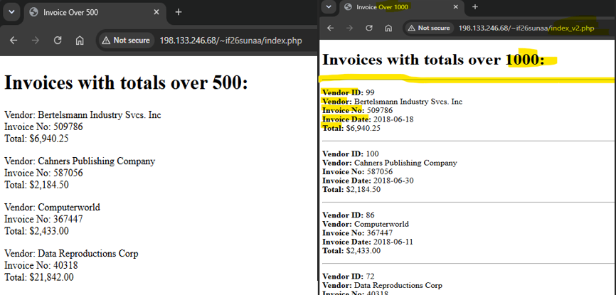
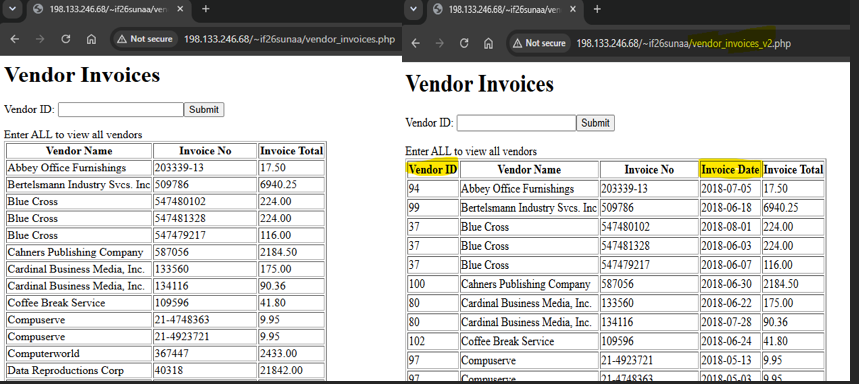

# MySQL Dynamic Webpage

<b>Table of Content</b>
- [Summary](#summary)
- [Author](#author)
- [New Concepts Used](#new-concepts-used)
- [Console Output Example](#console-output-testing-example)

## Summary
This assignment focused on a dynamic webpage connected to a MySQL database. The webpage retrieves invoice information from the database and displays invoices that meet a specific total amount. For the updated version, I made minor changes to the original, including changing the invoice filter from totals over $500 to totals over $1,000, adding Vendor ID and Invoice Date columns and making them bold.

## Author
[@suna2km](https://github.com/suna2km) Suna Aregay 

## New Concepts Used
- MySQL database queries: Retrieved invoice records directly from a database
- PHP and MySQL integration: Used PHP to connect the webpage to the database and work with database results.
- HTML formatting: Structured the dynamically generated invoice information so it could be displayed clearly on the webpage.

## Console Output Testing Example
### Invoices Before and After

### Vendor Invoices Before and After

[Back to Top](#mysql-dynamic-webpage)
