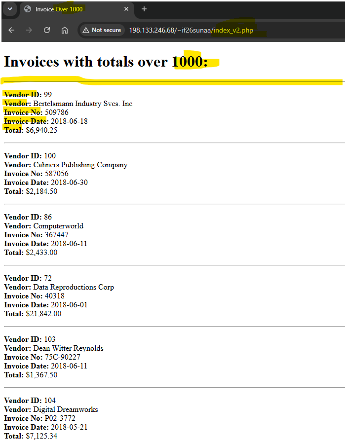
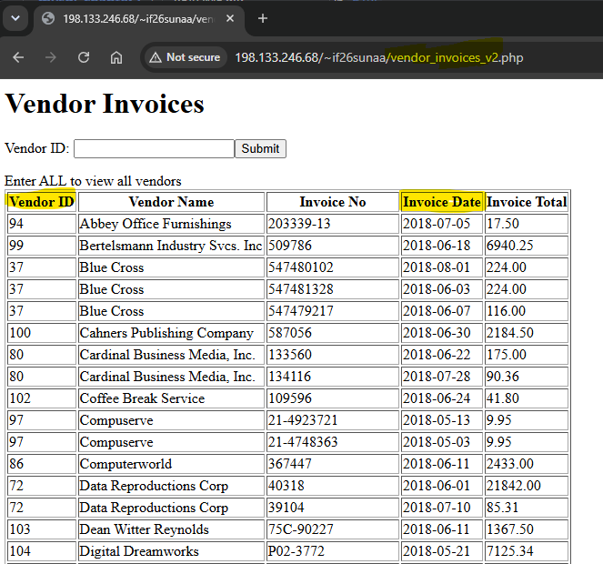

# MySQL Dynamic Webpage

<b>Table of Content</b>
- [Summary](#summary)
- [Author](#author)
- [New Concepts Used](#new-concepts-used)
- [Console Output Example](#console-output-testing-example)

## Summary
This is a MySQL Dynamic Webpage that: 
- Displays the program header
- Tells a few jokes
- Gets the user's name and welcomes to the user to the game
- Displays only one simple math question
- Gets the user's answer
- Says goodbye to the user 

## Author
[@suna2km](https://github.com/suna2km) Suna Aregay 

## New Concepts Used
- proper documentation
- proper code indentation
- declaring & initalizing variables
- cin & cout
- user-friendly interface

## Console Output Testing Example
### Invoices

### Vendor Invoices

[Back to Top](#mysql-dynamic-webpage)
